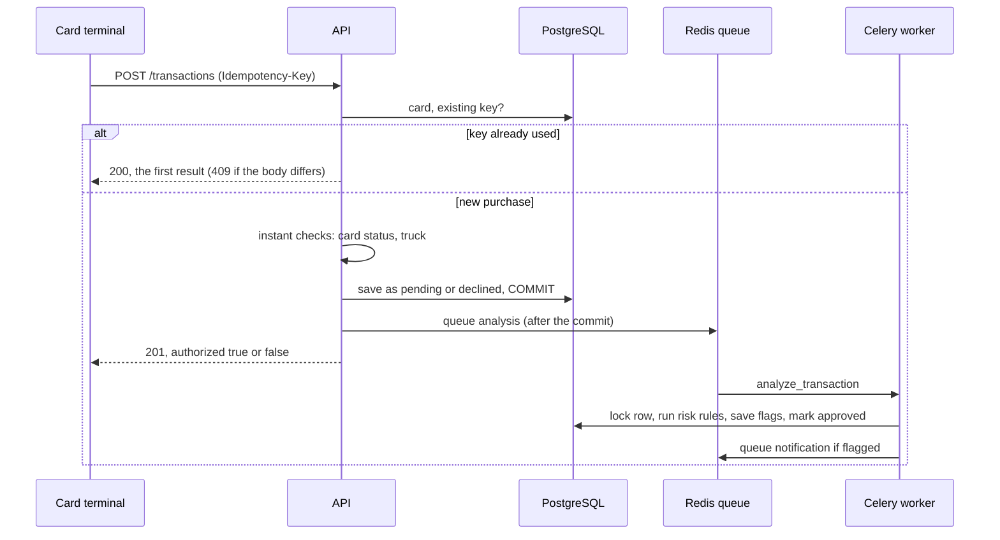
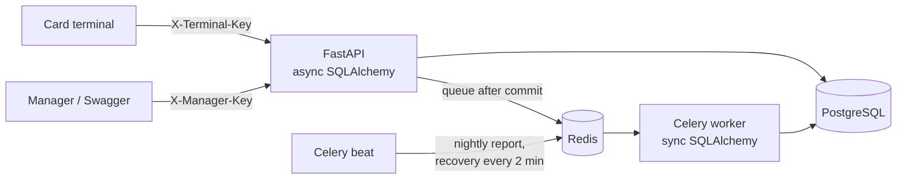
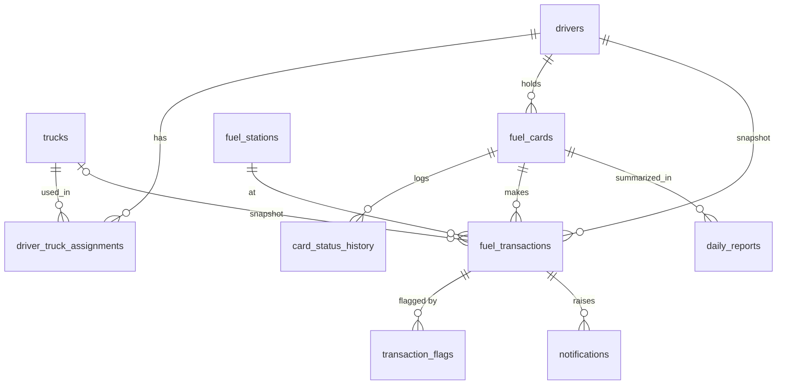

# FuelGuard

A backend service for a trucking company to manage drivers, trucks and fuel cards, record fuel
purchases, and flag risky transactions for review.

**Stack:** FastAPI · Pydantic v2 · PostgreSQL · SQLAlchemy 2 (async API, sync workers) · Alembic ·
Celery + Redis · Docker Compose · Pytest

- [Quick start](#quick-start)
- [Try it](#try-it-end-to-end)
- [How a purchase works](#how-a-purchase-works)
- [Risk rules](#risk-rules)
- [Background processing](#background-processing)
- [Error handling and retries](#error-handling-and-retries)
- [Architecture](#architecture)
- [Database design](#database-design)
- [API overview](#api-overview)
- [Configuration](#configuration)
- [Testing](#testing)
- [Design decisions and assumptions](#design-decisions-and-assumptions)
- [Scaling and limitations](#scaling-and-limitations)

## What the brief asked for, and where it is

| Requirement | Where |
|---|---|
| Manage drivers and trucks, assign drivers to trucks | `/drivers`, `/trucks`, `/drivers/{id}/assign-truck` |
| Issue cards; activate, deactivate, block; configure limits | `/cards`, `/cards/{id}/status`, `/cards/{id}/limits` |
| Simulate a fuel card purchase, validate against status and limits | `POST /transactions` ([flow](#how-a-purchase-works)) |
| Flag limit, tank, unusually large and burst purchases; keep them for review | [Risk rules](#risk-rules), `/transactions/flagged`, `/transactions/{id}/review` |
| At least two background workflows, with the reasoning | [Four workflows](#background-processing) on Celery + Redis |
| Alembic migrations, Docker Compose, tests, logging, env config, OpenAPI | `alembic/`, `docker-compose.yml`, 332 tests, `/docs` |

## Quick start

You need Docker with Compose. Nothing else is installed on your machine, and nothing is deployed
anywhere: everything runs locally and the ports are bound to `127.0.0.1` only.

```bash
cp .env.example .env        # the defaults work for local use; change the passwords and keys if you like
docker compose up --build   # builds the image, starts everything, applies the migrations
```

| What | Address |
|---|---|
| Swagger UI (try every endpoint) | http://localhost:8010/docs |
| ReDoc / OpenAPI JSON | http://localhost:8010/redoc · http://localhost:8010/openapi.json |
| Health check (database and Redis; 503 if either is down) | http://localhost:8010/health |
| PostgreSQL | `localhost:5442` (user, password and database from `.env`) |
| Redis | `localhost:6380` |

Five containers start: `api`, `worker` (Celery), `beat` (Celery scheduler), `db` and `redis`. The
`api` container runs `alembic upgrade head` before it starts serving.

In Swagger, click **Authorize** and enter the two keys from your `.env`: `MANAGER_API_KEY` for the
`ManagerKey` box and `TERMINAL_API_KEY` for the `TerminalKey` box.

Stop with `Ctrl+C` (or `docker compose down`). Add `-v` to also delete the database volume.

## Try it end to end

Run these from the project folder after `docker compose up`. On an empty database every ID below is `1`.

```bash
export MK=$(grep ^MANAGER_API_KEY= .env | cut -d= -f2)
export TK=$(grep ^TERMINAL_API_KEY= .env | cut -d= -f2)
API=http://localhost:8010
J='Content-Type: application/json'

# 1. Set up a station, a driver with a truck (100-gallon tank), and a card with limits
curl -s -X POST $API/stations -H "X-Manager-Key: $MK" -H "$J" -d '{"name":"Shell Highway 10"}'
curl -s -X POST $API/drivers  -H "X-Manager-Key: $MK" -H "$J" -d '{"full_name":"John Smith","license_number":"TX-1234567"}'
curl -s -X POST $API/trucks   -H "X-Manager-Key: $MK" -H "$J" -d '{"plate_number":"TX-4821","tank_capacity_gal":"100"}'
curl -s -X POST $API/drivers/1/assign-truck -H "X-Manager-Key: $MK" -H "$J" -d '{"truck_id":1}'
curl -s -X POST $API/cards    -H "X-Manager-Key: $MK" -H "$J" \
  -d '{"card_number":"7001-2345-6789","driver_id":1,"per_transaction_limit":"300","daily_limit":"500"}'

# 2. A normal purchase: accepted, no flags
curl -s -X POST $API/transactions -H "X-Terminal-Key: $TK" -H "$J" -H "Idempotency-Key: demo-0001" \
  -d '{"card_number":"7001-2345-6789","station_id":1,"gallons":"40","total_price":"150.00"}'

# 3. A suspicious purchase: 150 gallons into a 100-gallon tank for $450
curl -s -X POST $API/transactions -H "X-Terminal-Key: $TK" -H "$J" -H "Idempotency-Key: demo-0002" \
  -d '{"card_number":"7001-2345-6789","station_id":1,"gallons":"150","total_price":"450.00"}'

# 4. A moment later the worker has analyzed it. Review what was flagged:
sleep 2
curl -s $API/transactions/flagged -H "X-Manager-Key: $MK"
#    -> exceeds_transaction_limit (450 > 300), exceeds_daily_limit (150 + 450 = 600 > 500),
#       exceeds_tank_capacity (150 > 100), unusually_large (150 > 80), each with the numbers behind it
curl -s $API/notifications -H "X-Manager-Key: $MK"

# 5. Block the card: the next purchase is declined at the pump, and the attempt is still stored
curl -s -X PATCH $API/cards/1/status -H "X-Manager-Key: $MK" -H "$J" -d '{"status":"blocked"}'
curl -s -X POST $API/transactions -H "X-Terminal-Key: $TK" -H "$J" -H "Idempotency-Key: demo-0003" \
  -d '{"card_number":"7001-2345-6789","station_id":1,"gallons":"10","total_price":"35.00"}'
#    -> "authorized": false, "decline_reason": "card_blocked"

# 6. Build today's expense report on demand (it also runs every night)
curl -s -X POST "$API/reports/daily/run?report_date=$(date -u +%F)" -H "X-Manager-Key: $MK"
sleep 2; curl -s "$API/reports/daily?report_date=$(date -u +%F)" -H "X-Manager-Key: $MK"
```

## How a purchase works

`POST /transactions` is called by the card terminal (`X-Terminal-Key`) with a unique
`Idempotency-Key` header and `card_number`, `station_id`, `gallons`, `total_price` and an optional
`truck_id`. The server sets the transaction time (UTC), so a terminal cannot backdate a purchase.



**Instant checks** (in the request, in this fixed order; the first failure is the decline reason):

| Order | Check | Result |
|---|---|---|
| 1 | Card is `inactive` | declined, `card_inactive` |
| 2 | Card is `blocked` | declined, `card_blocked` |
| 3 | Driver has no truck assigned | declined, `no_vehicle` |
| 4 | Request names a `truck_id` that is not the assigned truck | declined, `vehicle_mismatch` |
| | Otherwise | saved as `pending`, `authorized: true` |

Only these checks decline a purchase. Spending limits, tank size and unusual patterns never block the
driver at the pump; they **flag** the purchase for a manager instead. A declined attempt is stored
like any other transaction, so nothing is silently discarded.

A manager lets a driver use a different truck by reassigning the driver (`assign-truck`).

An unknown card or station returns 404 and stores nothing (there is no card to attach it to).

## Risk rules

The worker runs these on every accepted purchase. A purchase can get several flags. Flags keep the
numbers behind them in `details`, so a reviewer sees why. Every threshold is a setting.

| Flag | Fires when | Default |
|---|---|---|
| `exceeds_transaction_limit` | this purchase's price is above the card's per-transaction limit | |
| `exceeds_daily_limit` | spending on the card in the last **24 hours** (including this one) is above its daily limit | |
| `exceeds_weekly_limit` | spending in the last **7 days** is above the weekly limit | |
| `exceeds_monthly_limit` | spending in the last **30 days** is above the monthly limit | |
| `exceeds_tank_capacity` | gallons are more than the truck's tank | |
| `unusually_large` | gallons are above **2 ×** the driver's average purchase; until the driver has **5** past purchases, above **80 %** of the tank | 2.0 / 5 / 0.8 |
| `card_frequency` | **3 or more** attempts on the card within **30 minutes** | 3 / 30 |
| `truck_frequency` | the same for the truck, across all cards | 3 / 30 |

Details that matter:

- A limit is only checked if it is set. A card with no limits is never limit-flagged.
- Limit windows are **rolling** (the last 24 h, 7 d, 30 d), not calendar days.
- Spending and averages count accepted purchases only. **Declined attempts count for the two
  frequency flags only**, because repeated tries on a blocked card are exactly what a manager wants to know about.
- Each purchase is judged by the history **up to its own timestamp**. Later purchases never affect an
  earlier one, so the result does not depend on which job happens to finish first.
- A declined attempt can get `card_frequency` and `truck_frequency` too (checked by a separate
  quick job), so a thief who is never approved is still noticed.

Managers review flags with `GET /transactions/flagged` (filter by reason, card, driver, truck, date,
review status) and close them with `PATCH /transactions/{id}/review` (`reviewed` or `dismissed`, with a
note). Reviewing never deletes anything.

## Background processing

**Choice: Celery + Redis**, not FastAPI `BackgroundTasks`.

| | `BackgroundTasks` | Celery + Redis |
|---|---|---|
| Runs in | the API process | separate worker processes |
| If the process crashes or restarts | the work is lost | queued jobs survive in Redis |
| Retries with backoff | you write them | built in |
| Scheduled jobs (nightly report, recovery) | needs another tool | Celery beat |
| Scale | tied to the API | add worker containers |

The brief asks how errors and retries are handled, and the money-related checks must not silently
vanish when a process restarts. `BackgroundTasks` would give neither, and it could not run the
nightly report. The cost is two extra containers (worker, beat) and Redis.

| Workflow | Trigger | What it does |
|---|---|---|
| **Risk analysis** `analyze_transaction` | after each accepted purchase | runs all risk rules, saves flags, marks the purchase `approved` |
| **Declined-attempt check** `check_declined_attempt` | after each declined attempt | burst check, so repeated failed attempts are flagged |
| **Notification** `notify_suspicious_transaction` | after a transaction gets flags | writes a warning to the log and a row in `notifications` |
| **Daily expense report** `daily_report` | Celery beat, 00:10 UTC (or `POST /reports/daily/run`) | one row per card and day: gallons, spend, count, flagged count |
| **Recovery** `recover_stuck_transactions` | Celery beat, every 2 minutes | re-queues anything that never finished (see below) |

Why `pending` then `approved`: the driver at the pump gets a fast answer from the instant checks. The
heavier analysis (several queries over a card's history) runs in the background, normally well under
a second after the purchase. A manager can see unfinished ones at `GET /transactions/stuck`.

## Error handling and retries

The rule behind the design: **the purchase is saved first, and everything after that can fail and be
repeated without losing or duplicating data.**

| What goes wrong | What happens |
|---|---|
| Terminal retries a purchase (timeout, double tap) | Same `Idempotency-Key` + same body returns the first result (HTTP 200). Same key + different body is a 409. A unique constraint on the key means even simultaneous retries create exactly one row. |
| Redis is down when the purchase arrives | The purchase is already committed, so the request still succeeds (201). The failure to queue is logged, the transaction stays `pending`, and the recovery job queues it once Redis is back. |
| Database error inside a worker job (connection lost, restart) | The job retries automatically with exponential backoff and jitter (about 1 s, 2 s, 4 s, ... capped at 60 s), up to `ANALYSIS_MAX_RETRIES` (5) times. Each attempt is one database transaction, so a failure leaves no half-written flags. |
| Retries run out | An error is logged with the transaction ID. The transaction **stays `pending`**; it is never dropped or silently approved. It shows in `GET /transactions/stuck`, and the recovery job tries again later. |
| A worker dies in the middle of a job | The message is acknowledged only after the job finishes (`acks_late`) and is re-delivered if the worker is lost (`reject_on_worker_lost`). |
| The same job runs twice (retry, duplicate message, recovery) | Jobs are **idempotent**: the transaction row is locked, anything not `pending` is skipped, flags have a unique constraint per transaction and reason, and notifications are created once. Running twice changes nothing. |
| Notification could not be queued after the flags were saved | Logged. The recovery job also finds flagged transactions that have no notification and queues them. |
| A bug in a job (not a database error) | Not retried (retrying cannot fix it); logged by the task failure handler. |
| Someone needs to know whether the service can work right now | `GET /health` checks PostgreSQL and Redis (3 s timeout each) and returns 503 with `{"checks": {"database": "ok", "redis": "error"}}` when one is down. It does not check that a worker is running; unfinished background work shows in `GET /transactions/stuck`. |
| Unexpected exception in the API | Returned as a generic `500` in the standard error format. Details go to the log, never to the client. |

All API errors share one JSON shape, with a stable `code` for programs and a `message` for people:

```json
{ "error": { "code": "conflict", "message": "A card with this number already exists", "details": null } }
```

Codes: `validation_error` (422, with the failing fields in `details`), `not_found` (404), `conflict` (409),
`invalid_state` (422), `http_error` (401/403), `internal_error` (500).

**Recovery job** (every 2 minutes): finds transactions still `pending` after 5 minutes, declined
attempts not yet checked, and flagged transactions without a notification, and queues the right job
again. Because the jobs are idempotent, re-queuing work that was only slow is harmless.

**Concurrency control.** Races are handled in the database, not in Python: the unique idempotency key,
a partial unique index (one *current* truck per driver), unique constraints on cards, licenses and plates, and
`SELECT ... FOR UPDATE` row locks when a card's status, a driver, or a transaction is changed.

## Architecture



- **API** is async and stateless, so it can run as many copies as needed.
- **Workers** use a small synchronous database layer, because Celery tasks are synchronous. The two sides
  share only the models. The API never imports worker code: it sends tasks **by name**
  (`app/workers/names.py`), so the two can be deployed separately.
- **Risk rules are pure functions** (`app/services/risk_rules.py`): numbers in, flags out, no database.
  The worker gathers the numbers (`app/workers/risk_analysis.py`) and the rules decide. That keeps the
  rules easy to read and to unit test.

```
app/
  main.py                FastAPI app, routers, error handlers
  api/                   routers: drivers, trucks, cards, stations, transactions, notifications, reports
  schemas/               Pydantic v2 request and response models
  services/              business logic (async): fleet, cards, purchases, review, reports
                         risk_rules.py = the pure risk rules
  workers/               Celery app, tasks, risk_analysis.py (sync DB logic), dispatch.py (queueing)
  models/                SQLAlchemy models        db/   engines and sessions (async + sync)
  core/                  settings, logging, errors, API key security
alembic/                 migrations (the schema is created only through Alembic)
tests/                   unit/  integration/  workers/
```

## Database design



| Table | Notes |
|---|---|
| `drivers`, `trucks` | Soft delete (`is_active`), so history keeps pointing at them. Truck has `tank_capacity_gal`. |
| `driver_truck_assignments` | History of who drove what. `unassigned_at IS NULL` means current. A partial unique index allows one current truck per driver; several drivers may share a truck. |
| `fuel_cards` | Status `active` / `inactive` / `blocked`; four optional limits (per transaction, daily, weekly, monthly). |
| `card_status_history` | Who changed a card's status, and when (including automatic changes). |
| `fuel_transactions` | Card, driver, truck and station, gallons, price, server UTC time, status `pending` / `approved` / `declined`, decline reason, review fields. Unique `idempotency_key`. |
| `transaction_flags` | One row per reason per transaction (unique), with a JSON `details` of the numbers. |
| `notifications`, `daily_reports` | Alerts for managers; one report row per card and day (unique, so re-running updates it). |

Choices worth knowing:

- **Money and gallons are `Numeric`**, never float; all timestamps are timezone-aware UTC.
- **A transaction stores the driver and truck as they were at purchase time.** Reassigning a driver
  later does not rewrite history.
- **Enums are stored as text**, so adding a status or flag reason does not need a special migration.
- **Indexes** match the queries the rules run: `(card_id, transaction_time)`, `(truck_id, transaction_time)`,
  and a partial index on `pending` transactions for the recovery job.
- Check constraints keep bad data out even if the application has a bug (positive limits, gallons and tank size).

## API overview

Interactive documentation with request examples and error responses: **http://localhost:8010/docs**.
Lists accept `limit` (1–100, default 50) and `offset`.

| Area | Endpoints | Key |
|---|---|---|
| Drivers | `POST/GET /drivers`, `GET/PATCH/DELETE /drivers/{id}`, `POST /drivers/{id}/assign-truck`, `POST /drivers/{id}/unassign-truck`, `GET /drivers/{id}/assignments` | manager |
| Trucks | `POST/GET /trucks`, `GET/PATCH/DELETE /trucks/{id}` | manager |
| Cards | `POST/GET /cards`, `GET /cards/{id}`, `PATCH /cards/{id}/status`, `PATCH /cards/{id}/limits`, `GET /cards/{id}/history` | manager |
| Stations | `POST/GET /stations`, `GET /stations/{id}` | manager |
| Purchase | `POST /transactions` | **terminal** |
| Review | `GET /transactions`, `GET /transactions/flagged`, `GET /transactions/stuck`, `GET /transactions/{id}`, `PATCH /transactions/{id}/review` | manager |
| Alerts | `GET /notifications`, `PATCH /notifications/{id}/read` | manager |
| Reports | `GET /reports/daily`, `POST /reports/daily/run` | manager |
| Health | `GET /health` (200 when PostgreSQL and Redis answer, otherwise 503 with the failing check named) | none |

`DELETE` on a driver or truck is a soft delete. Deleting a driver also closes the driver's truck
assignment and switches the driver's active cards to `inactive` (blocked cards stay blocked), so a removed
driver cannot keep fuelling.

## Configuration

Everything comes from environment variables (`.env`, see `.env.example`). The app refuses to start if a
required setting is missing, and API keys must be at least 8 characters.

| Setting | Purpose | Default |
|---|---|---|
| `DATABASE_URL_ASYNC`, `DATABASE_URL_SYNC` | database for the API (asyncpg) and for workers and Alembic (psycopg2) | |
| `REDIS_URL` | Celery broker and result backend | |
| `MANAGER_API_KEY`, `TERMINAL_API_KEY` | the two API keys | |
| `LOG_LEVEL`, `LOG_FORMAT` | `text` or `json` log lines | `INFO`, `text` |
| `FREQUENCY_MAX_PURCHASES`, `FREQUENCY_WINDOW_MINUTES` | burst rule | 3, 30 |
| `LARGE_PURCHASE_MULTIPLIER`, `LARGE_PURCHASE_MIN_HISTORY`, `LARGE_PURCHASE_FALLBACK_TANK_RATIO` | unusually large rule | 2.0, 5, 0.8 |
| `ANALYSIS_MAX_RETRIES` | retries for background jobs | 5 |
| `STUCK_AFTER_MINUTES`, `RECOVERY_INTERVAL_SECONDS` | recovery job | 5, 120 |

## Testing

```bash
docker compose run --rm --build tests
```

**332 tests, all against a real PostgreSQL** (no SQLite, no mocked database), 100 % line coverage of `app/`.

| Folder | Tests | What |
|---|---|---|
| `tests/unit` | 56 | the risk rules (including exact boundaries), schema validation, settings, logging, queue-outage handling |
| `tests/integration` | 184 | every endpoint through the real app: auth, validation, error format, purchase decisions and their priority, idempotency, review, reports, health check, parallel requests, migrations |
| `tests/workers` | 92 | the analysis against backdated history, burst checks, notifications, reports, recovery, and **retries** (flaky database, giving up, no half-written data) |

How the tests stay safe and honest:

- They use their own database, `fuelguard_test`, built from the **Alembic migrations** (so the migrations are
  tested too, including a downgrade and upgrade). The tests refuse to run against any database whose name
  does not end in `_test`.
- Redis is never touched: queueing is replaced by a list that tests can inspect.
- Race conditions are tested with real parallel requests (simultaneous retries of one purchase, competing
  status changes and assignments).
- Backdated history (needed for the 24 h / 7 d / 30 d windows) is inserted directly into the database,
  because the API correctly refuses to accept a client-chosen time.
- Coverage alone does not prove a test can fail, so key rules were also broken on purpose (for example a
  limit check changed from `>` to `>=`, or a window from 7 to 8 days) to confirm the suite catches each one.

To run a part, for example `docker compose run --rm tests pytest tests/unit -q`. For a coverage report:
`docker compose run --rm tests pytest --cov=app`.

## Design decisions and assumptions

The brief leaves some things open. These are the choices made, and why.

| Question | Decision | Why |
|---|---|---|
| Reject or flag a risky purchase? | Decline only on card status and truck problems; **flag** everything else | A driver should not be stranded at the pump by a limit rule, but a manager must still see it. Both "validate" and "keep for review" are honored. |
| Can a blocked card be unblocked? | Yes, any status can change to any other | A block can be lifted when a fraud report is withdrawn. Every change is logged. |
| Which limits? | Per transaction, daily, weekly, monthly, all optional | Covers one big purchase and slow overspending. |
| Calendar days or rolling windows? | Rolling (24 h / 7 d / 30 d) | No loophole at midnight. |
| How is the truck chosen? | From the driver's current assignment; an optional `truck_id` must match it | Prevents using a card on the wrong vehicle. A manager reassigns to allow a change. |
| Who sets the transaction time? | The server | A terminal cannot backdate to dodge a window. |
| Unusually large | Compared with the driver's own average, with a tank-share fallback for new drivers | A fixed number would be wrong for both small vans and big trucks. |
| Authentication | Two API keys from the environment (manager, terminal) | The brief did not ask for user accounts. Kept simple and testable; see limitations. |
| Async or sync database code? | Async in the API, sync in the workers | The API benefits from async; Celery tasks are synchronous. They share only the models. |
| Microservices? | No: one codebase, one database | Right-sized for this scope. The API and workers are already separate processes that talk through a queue by task name, so they could be split later. |
| No frontend | The API and its Swagger UI are the interface | The brief is backend-only. |

## Scaling and limitations

**Scaling.** The API and workers are stateless, so they scale out by running more containers behind a load
balancer (for example `docker compose up --scale worker=4`; the API needs a load balancer and a port change to
run several copies). Jobs are idempotent and rows are locked, so many workers cannot duplicate work. The
database is the part that grows hardest: next steps would be read replicas for reports and partitioning
`fuel_transactions` by date. As delivered, Compose runs everything on one machine.

**Known limitations.**

- **No user accounts.** Two shared API keys, and every manager action is recorded as `manager`. Real
  deployments would use per-user login with roles and an audit trail.
- **A job that fails for a non-temporary reason** is not retried by Celery, but the recovery job will
  re-queue it every 2 minutes and it will fail again, with a log line each time. It is visible in
  `/transactions/stuck`, but there is no alerting or dead-letter queue.
- **Notifications are a log line plus a database row.** Email, chat or a webhook would be the next step.
- **No rate limiting, metrics or tracing.**
- **Reports are by UTC day.** Per-timezone reports would need a company time zone setting.
- **Tank check is simple.** It compares one purchase with the tank size; the current fuel level is not known.
- **Old data is never archived** (flags, notifications, history grow without limit).
